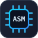

<div align="center">
  
</div>

<table>
  <tr>
    <td width="25%" align="center" valign="middle">
      <a href="https://portofthrxyz.vercel.app">
        <br />
        <strong>PORTFOLIO &nearr;</strong>
      </a><br />
      <sub><code>portofthrxyz.vercel.app</code></sub>
    </td>
    <td width="25%" align="center" valign="middle">
      <a href="https://github.com/fhariyadi-dev/askyuna-starter-kit">
        <br />
        <strong>AI AGENT &nearr;</strong>
      </a><br />
      <sub><code>@askyuna.ai</code></sub>
    </td>
    <td width="25%" align="center" valign="middle">
      <a href="https://instagram.com/fthr.xjz">
        <br />
        <strong>INSTAGRAM &nearr;</strong>
      </a><br />
      <sub><code>@fthr.xjz</code></sub>
    </td>
    <td width="25%" align="center" valign="middle">
      <a href="mailto:hallo@fathurrahmanh.me">
        <br />
        <strong>EMAIL &nearr;</strong>
      </a><br />
      <sub><code>hallo@fathurrahmanh.me</code></sub>
    </td>
  </tr>
</table>

<div align="center">
  
</div>

## `01` // Developer Brief

<table>
  <tr>
    <td width="54%" valign="top">

```yaml
# ~/.config/fathur.yml
identity:
  name: "Fathurrahman Hariyadi"
  alias: ["fthrxyzz", "fhariyadi-dev"]
  pronouns: "he/him"
  location: "Lampung, Indonesia 🇮🇩"
  email: "hallo@fathurrahmanh.me"

profile:
  role: "Web & Software Developer"
  ai_partner: "Yuna AI (@askyuna.ai)"

interests:
  - "Modern Web & Frontend Engineering"
  - "AI Agent Workflows & Automation"
  - "Clean UI/UX & Interactive Design"
  - "Algorithms & Systems (C++ / Low-Level)"
```

</td>
    <td width="46%" valign="top">

### Current Mission

- **Building** responsive web apps with **React 19**, **TypeScript**, **Vite**, and **Tailwind CSS v4**.
- **Developing** personal AI coding workflows & starter kits via [`askyuna-starter-kit`](https://github.com/fhariyadi-dev/askyuna-starter-kit).
- **Sharpening** software engineering fundamentals across algorithms, data structures, and systems programming in **C++**.
- **Open to** web development collaborations, open-source projects, and software engineering opportunities.

> *"Code cleanly, ship iteratively, and turn complex ideas into interfaces people enjoy using."*

</td>
  </tr>
</table>

<div align="center">
  
</div>

## `02` // Tech Deck

<div align="center">

#### Dev Environment, Frameworks &amp; Tools

<p>
  
  &nbsp;
  
</p>
<p><sub><code>Antigravity</code> · <code>VS Code</code> · <code>React</code> · <code>Vite</code> · <code>Tailwind CSS</code> · <code>Vercel</code> · <code>Git</code> · <code>GitHub</code></sub></p>

<br />

#### Core Languages

<p>
  
  &nbsp;
  
</p>
<p><sub><code>TypeScript</code> · <code>JavaScript</code> · <code>C++</code> · <code>HTML5</code> · <code>CSS3</code> · <code>x86 Assembly (emu8086)</code></sub></p>

</div>

<div align="center">
  
</div>

## `03` // Selected Works

<table>
  <tr>
    <td width="50%" valign="top">
      <h3><a href="https://github.com/fhariyadi-dev/portofthrxyz">portofthrxyz</a></h3>
      <p>Personal developer portfolio built with smooth motion transitions, responsive layout, and modern component architecture.</p>
      <p>
        <code>TypeScript</code> <code>React 19</code> <code>Tailwind v4</code> <code>Vite</code>
      </p>
      <a href="https://portofthrxyz.vercel.app" target="_blank">Live Preview &rarr;</a>
    </td>
    <td width="50%" valign="top">
      <h3><a href="https://github.com/fhariyadi-dev/askyuna-starter-kit">askyuna-starter-kit</a></h3>
      <p>Starter kit and practical playbook for building and customizing personal AI coding agent workflows — Yuna AI by Fathurrahman.</p>
      <p>
        <code>AI Agent</code> <code>Workflows</code> <code>Prompt Design</code>
      </p>
      <a href="https://github.com/fhariyadi-dev/askyuna-starter-kit" target="_blank">Explore Guide &rarr;</a>
    </td>
  </tr>
  <tr>
    <td width="50%" valign="top">
      <h3><a href="https://github.com/fhariyadi-dev/WebsiteTONIMERP">WebsiteTONIMERP</a></h3>
      <p>Next-generation web portal and interactive community hub built for The Old Norse Roleplay ecosystem.</p>
      <p>
        <code>JavaScript</code> <code>Web UI</code> <code>Vercel</code>
      </p>
      <a href="https://theoldnorsethenextgen.vercel.app" target="_blank">Live Preview &rarr;</a>
    </td>
    <td width="50%" valign="top">
      <h3><a href="https://github.com/fhariyadi-dev/Sistem-Pembagian-Tagihan-Pengeluaran-Kost">Sistem Pembagian Tagihan Kost</a></h3>
      <p>Dormitory shared-expense and bill-splitting CLI application engineered for fair and fast monthly expense calculations.</p>
      <p>
        <code>C++</code> <code>CLI System</code> <code>Algorithms</code>
      </p>
      <a href="https://github.com/fhariyadi-dev/Sistem-Pembagian-Tagihan-Pengeluaran-Kost" target="_blank">View Source &rarr;</a>
    </td>
  </tr>
  <tr>
    <td width="50%" valign="top">
      <h3><a href="https://github.com/fhariyadi-dev/Website-Penjadwalan-Mata-Kuliah">Website Penjadwalan Mata Kuliah</a></h3>
      <p>Interactive course scheduling web application crafted with generative-AI assisted web development practices.</p>
      <p>
        <code>HTML5</code> <code>CSS3</code> <code>JavaScript</code> <code>Gen AI</code>
      </p>
      <a href="https://website-penjadwalan-mata-kuliah.vercel.app" target="_blank">Live Preview &rarr;</a>
    </td>
    <td width="50%" valign="top">
      <h3><a href="https://github.com/fhariyadi-dev/tonvault.my.id">tonvault.my.id</a></h3>
      <p>Lightweight digital vault and resource catalog web platform deployed seamlessly for community access.</p>
      <p>
        <code>JavaScript</code> <code>Frontend</code> <code>Vercel</code>
      </p>
      <a href="https://tonvault-my-id.vercel.app" target="_blank">Live Preview &rarr;</a>
    </td>
  </tr>
</table>

<div align="center">
  
</div>

## `04` // GitHub Telemetry

<div align="center">
  
  
</div>

<br />

<div align="center">
  
</div>

<br />

<div align="center">
  
</div>

<br />

<div align="center">
  
</div>

## `05` // Arcade Console — YUNA-BOT Commit Defender

<div align="center">
  
</div>

<br />

<div align="center">
  
</div>
