<div align="center">
  
</div>

<br />

<div align="center">
  <a href="https://portofthrxyz.vercel.app" target="_blank">
    
  </a>
  <a href="mailto:ganzfathur9@gmail.com">
    
  </a>
  <a href="https://instagram.com/fthr.xjz" target="_blank">
    
  </a>
  
</div>

<br />

<div align="center">
  
</div>

## `01` // Developer Brief

<table>
  <tr>
    <td width="54%" valign="top">

```yaml
# ~/.config/fathur.yml
identity:
  name: "Fathur Hariyadi"
  alias: ["fthrxyzz", "fhariyadi-dev"]
  pronouns: "he/him"
  location: "Lampung, Indonesia 🇮🇩"

education:
  current: "B.Sc. Computer Science — Universitas Lampung"
  previous: "Informatics Engineering — UAD"

interests:
  - "Modern Web & Frontend Engineering"
  - "AI Agent Systems (@askyuna.ai)"
  - "Clean UI/UX & Interactive Design"
  - "Algorithms & Systems (C++ / Low-Level)"
```

</td>
    <td width="46%" valign="top">

### Current Mission

- **Building** responsive web apps with **React 19**, **TypeScript**, **Vite**, and **Tailwind CSS v4**.
- **Experimenting** with personal AI coding workflows & starter kits via [`askyuna-starter-kit`](https://github.com/fhariyadi-dev/askyuna-starter-kit).
- **Sharpening** computer science fundamentals across data structures, algorithms, and systems programming in **C++**.
- **Open to** web development collaborations, open-source projects, and software engineering opportunities.

> *"Code cleanly, ship iteratively, and turn complex ideas into interfaces people enjoy using."*

</td>
  </tr>
</table>

<div align="center">
  
</div>

## `02` // Tech Arsenal

<table>
  <tr>
    <td width="22%"><strong>Languages</strong></td>
    <td>
      
      
      
      
      
      
    </td>
  </tr>
  <tr>
    <td><strong>Frontend &amp; UI</strong></td>
    <td>
      
      
      
      
      
    </td>
  </tr>
  <tr>
    <td><strong>Tools &amp; Cloud</strong></td>
    <td>
      
      
      
      
      
    </td>
  </tr>
</table>

<div align="center">
  
</div>

## `03` // Selected Works

<table>
  <tr>
    <td width="50%" valign="top">
      <h3><a href="https://github.com/fhariyadi-dev/portofthrxyz">portofthrxyz</a></h3>
      <p>Personal developer portfolio built with smooth motion transitions, responsive layout, and modern component architecture.</p>
      <p>
        <code>TypeScript</code> <code>React 19</code> <code>Tailwind v4</code> <code>Vite</code>
      </p>
      <a href="https://portofthrxyz.vercel.app" target="_blank">Live Preview &rarr;</a>
    </td>
    <td width="50%" valign="top">
      <h3><a href="https://github.com/fhariyadi-dev/askyuna-starter-kit">askyuna-starter-kit</a></h3>
      <p>Starter kit and practical playbook for building and customizing personal AI coding agent workflows — Yuna by Fathur.</p>
      <p>
        <code>AI Agent</code> <code>Workflows</code> <code>Prompt Design</code>
      </p>
      <a href="https://github.com/fhariyadi-dev/askyuna-starter-kit" target="_blank">Explore Guide &rarr;</a>
    </td>
  </tr>
  <tr>
    <td width="50%" valign="top">
      <h3><a href="https://github.com/fhariyadi-dev/WebsiteTONIMERP">WebsiteTONIMERP</a></h3>
      <p>Next-generation web portal and interactive community hub built for The Old Norse Roleplay ecosystem.</p>
      <p>
        <code>JavaScript</code> <code>Web UI</code> <code>Vercel</code>
      </p>
      <a href="https://theoldnorsethenextgen.vercel.app" target="_blank">Live Preview &rarr;</a>
    </td>
    <td width="50%" valign="top">
      <h3><a href="https://github.com/fhariyadi-dev/Sistem-Pembagian-Tagihan-Pengeluaran-Kost">Sistem Pembagian Tagihan Kost</a></h3>
      <p>Dormitory shared-expense and bill-splitting application developed as Computer Science Semester 1 Final Project at UNILA.</p>
      <p>
        <code>C++</code> <code>CLI System</code> <code>UNILA</code>
      </p>
      <a href="https://github.com/fhariyadi-dev/Sistem-Pembagian-Tagihan-Pengeluaran-Kost" target="_blank">View Source &rarr;</a>
    </td>
  </tr>
  <tr>
    <td width="50%" valign="top">
      <h3><a href="https://github.com/fhariyadi-dev/Website-Penjadwalan-Mata-Kuliah">Website Penjadwalan Mata Kuliah</a></h3>
      <p>Interactive course scheduling web application crafted with generative-AI assisted web development practices.</p>
      <p>
        <code>HTML5</code> <code>CSS3</code> <code>JavaScript</code> <code>Gen AI</code>
      </p>
      <a href="https://website-penjadwalan-mata-kuliah.vercel.app" target="_blank">Live Preview &rarr;</a>
    </td>
    <td width="50%" valign="top">
      <h3><a href="https://github.com/fhariyadi-dev/tonvault.my.id">tonvault.my.id</a></h3>
      <p>Lightweight digital vault and resource catalog web platform deployed seamlessly for community access.</p>
      <p>
        <code>JavaScript</code> <code>Frontend</code> <code>Vercel</code>
      </p>
      <a href="https://tonvault-my-id.vercel.app" target="_blank">Live Preview &rarr;</a>
    </td>
  </tr>
</table>

<div align="center">
  
</div>

## `04` // GitHub Telemetry

<div align="center">
  
  
</div>

<br />

<div align="center">
  
</div>

<br />

<div align="center">
  
</div>

<br />

<div align="center">
  
</div>
